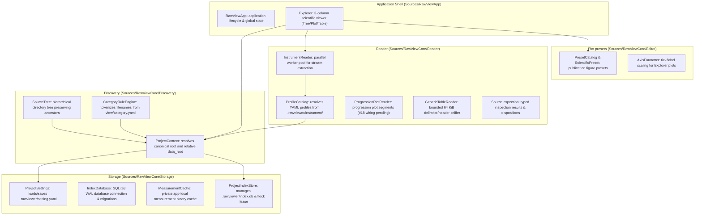

# RawView Developer and Agent Guide

This file defines the architecture, invariant contracts, and component graph for AI agents working on RawView.

## Register and Rules

Write instructions in Plain register: short imperative sentences, active voice, one instruction per sentence.
Never delete or split existing source files without explicit human authorization.
Raw scientific data files under project data roots are strictly read-only and immutable.
Cover every acceptance case named in a task contract with tests.
Give each acceptance case its own named test or shared vector row.
When a case has multiple values, columns, or elements, assert every value in the test, not only the first.
Map each contract acceptance case to its test or vector in the pull request body under `## Acceptance case → test mapping` (ASCII `->` is also accepted in the heading).
List every repo-relative path or glob the task owns in the pull request body under `## Owned files`, one entry per line.
Do not edit files outside that owned list without explicit human approval.
Wire Rust and Swift grammar parity tests to shared fixtures under `fixtures/grammar/`; do not pin compile regex strings in only one language.

The `pr-acceptance-mapping` CI job is **advisory**: it is not a required GitHub ruleset check for merge, and Tai decides separately whether to treat it as mandatory. The job only verifies that the mapping **table exists** with at least one non-placeholder row (placeholder rows containing `(example)` fail). Reviewers and verifiers still confirm the mapping is **correct and complete** against the task contract and that tests cover every case.

The `pr-owned-files` CI job is **advisory**: it is not a required GitHub ruleset check for merge, and Tai decides separately whether to treat it as mandatory. The job only verifies that the PR body declares `## Owned files` and that every changed path in the PR matches a declared entry. It does not detect scope creep inside an owned file (for example an unapproved schema field added only in YAML or Rust under an owned path). Reviewers still own contract fidelity and semantic scope.

## Knowledge Graph and Component Map (Graphify)

The Swift package lives in `apps/macos/`. Paths in the map below are relative to that package.

RawView is organized into five decoupled core layers and a single Explorer workspace in the macOS app.

## Invariants and Contracts

1. **Storage Invariant (Swift, pending 24a-2 alignment)**: Writable index on macOS remains project-local in Swift today; **Rust** places writable index under owner-private cache (`<platform-cache>/raw-viewer/projects/<sha256>/index.db`) and never writes SQLite inside the project. Legacy `data/.rawview/index.db` is read-only hints.
2. **Settings Invariant (Rust)**: Project configuration for the Rust core is `<project>/.raw-viewer/config.yaml` with `schema_version: 1`. Defaults: data root `data/raw`, view `tree`, preset `nature-single`. Swift still uses `.rawviewer/setting.yaml` until 24a-2.
3. **Profile Fallback**: Profiles load from `<project>/.raw-viewer/profiles/` first, then `<project>/.rawviewer/instrument/`, then `data/.rawview/instrument/`, then `data/instruments/` (companion `rawview/` when present; ignore empty directories). The app never writes profile YAML under `.raw-viewer/profiles/` or `.rawviewer/instrument/` (read-only consumption). Schema **v4** is one flat YAML per instrument (`schema_version: 4`, namespaced top-level `id`, `variants:` map keyed by application-mode); v1–v3 profiles still load for compatibility.
4. **Verification**: Always run `./apps/macos/Scripts/check_core.sh` and `./apps/macos/Scripts/check_index_cli.sh` before declaring completion. Rust workspace checks are `cargo fmt --check`, `cargo clippy --workspace --all-targets -- -D warnings`, and `cargo test --workspace` from the repository root.

## Rule enforcement

The gardener owns this table. Update it when rules or checks change.

| Rule (AGENTS.md) | Enforcing check | Status |
| --- | --- | --- |
| L7 — Write instructions in Plain register (short imperative sentences). | none | unenforced |
| L8 — Never delete or split existing source files without explicit human authorization. | none | unenforced |
| L9 — Raw scientific data under project data roots are read-only and immutable. | `apps/macos/Scripts/check_index_cli.sh:53-77` (macOS `stat -f`; swift CI job only) | partial |
| L13 — Graphify paths are relative to the Swift package in `apps/macos/`. | `.github/workflows/ci.yml:57-59` (swift job `working-directory: apps/macos`) | partial |
| L63 — Storage invariant (writable index only under `<project>/.rawviewer/index.db`; no other project-local SQLite writes). | `apps/macos/Scripts/CoreSelfCheck.swift:2845-2858`, `3656-3657` (`projectIndexStoreSelfCheck`) | partial |
| L64 — Settings invariant (`.raw-viewer/config.yaml` Rust; `.rawviewer/setting.yaml` Swift; default view `tree`; default preset `nature-single`). | `core/tests/project_layout_config.rs`; `apps/macos/Scripts/check_index_cli.sh:65-69`; `core/src/config.rs` (`DEFAULT_*`) | partial |
| L65 — Profile fallback (`.raw-viewer/profiles/` first; load order; no writes under profile dirs). | `apps/macos/Scripts/CoreSelfCheck.swift` (priority/fallback); `core/tests/profile_catalog_discovery.rs`; Rust project write-ban: `core/tests/project_layout_write_ban.rs` | partial |
| L9 — Rust core never writes inside a project tree. | `core/tests/project_layout_write_ban.rs` (`write_ban_opening_fixtures_leaves_project_tree_unchanged`) | enforced |
| L66 — Verification gate (macOS check scripts + Rust fmt/clippy/test). | `.github/workflows/ci.yml:46-51`, `73-76` | partial |
| L10–L13 — Task contract acceptance coverage and PR mapping. | `Scripts/check_pr_acceptance_mapping.sh` and `Scripts/check_pr_acceptance_mapping_self_test.sh`; `.github/workflows/ci.yml` (`pr-acceptance-mapping` job, advisory); named tests/vectors, mapping correctness/completeness, and full multi-value assertions are review-/verifier-enforced | partial |
| L14–L16 — Task owned-file list in PR body; no edits outside owned paths without human approval. | `Scripts/check_pr_owned_files.sh` and `Scripts/check_pr_owned_files_self_test.sh`; `.github/workflows/ci.yml` (`pr-owned-files` job, advisory); semantic creep inside owned files is review-/verifier-enforced | partial |
| L14 — Rust/Swift cross-language grammar test parity (shared fixtures; no hand-copied compile regex). | `Scripts/check_cross_language_test_contract.sh`, `Scripts/check_cross_language_test_contract_self_test.sh`, `fixtures/grammar/cross_language_contract.yaml`; `.github/workflows/ci.yml` (`cross-language-test-contract` job); profile/progression assertions outside grammar vectors remain review-enforced | partial |
| CI must be green on required jobs before merge. | `.github/workflows/ci.yml` (rust matrix, swift job) | enforced |

Required GitHub status checks on `master` are not configured (Tai's decision).

## Agent instruction index (`.agents/`)

`.agents/` is the tool-neutral home for agent skills, rules, and workflows. Planned install targets (#20/#25): `~/.agents/skills` and `~/.claude/skills`. Nothing in this repo reads `.cursor/` for these instructions.

| Path | Purpose |
| --- | --- |
| `.agents/rules/graphify.md` | Graphify rule pack for architecture maps |
| `.agents/workflows/graphify.md` | Graphify workflow steps |
| `.agents/skills/rawview-setup-grammar/SKILL.md` | Generate `.rawviewer/grammar.yaml` and source labels |
| `.agents/skills/rawview-setup-profile/SKILL.md` | Author instrument profiles from raw files |
| `.agents/skills/verify-raw-viewer/SKILL.md` | Linux Rust-core verification and proof logs |

**Staleness notes (follow-up issues):**

- `graphify-out/` output directory may be missing until Graphify runs in a checkout.
- Setup skills may still reference pre-`.agents/` paths; align with #20 when the install pipeline lands.
- Setup profile skill targets Schema v3; schema **v4** (flat `variants:` map keyed by application-mode, namespaced `id`, `rows`/`plot`/`when` on the profile) lands in #18b — see `core/src/profile/v4.rs` and `InstrumentProfileV4.swift`.
- Contract **18c-1** (`when` matching, exact basename tokens, `ambiguous_profile`): see `docs/handoff/2026-10-31-when-matcher-18c1.md` and `core/tests/when_matcher.rs` / `WhenMatcherTests.swift`.
