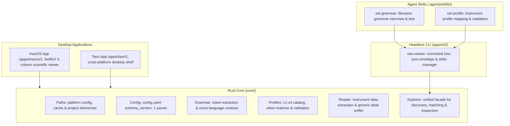

# RawView Developer and Agent Guide

This file defines the architecture, invariant contracts, and development rules for AI agents working on RawView.

## Register and Operating Rules

Write instructions in Plain register: short imperative sentences, active voice, one instruction per sentence.
Never delete or split existing source files without explicit human authorization.
Raw scientific data files under project data roots are strictly read-only and immutable.
Cover every acceptance case named in a task contract with automated tests.
Give each acceptance case its own named test or shared vector row.
When a case has multiple values, columns, or elements, assert every value in the test, not only the first.
Map each contract acceptance case to its test or vector in the pull request body under `## Acceptance case → test mapping`.
List every repository-relative path the task owns in the pull request body under `## Owned files`, one entry per line.
Do not edit files outside that owned list without explicit human approval.
Wire Rust and Swift grammar parity tests to shared fixtures under `fixtures/grammar/`; do not pin compile regex strings in only one language.
Do not modify `RELEASE_GATE.md` unless explicitly instructed.

## Component Architecture

RawView is organized into decoupled layers:



## Invariants and Contracts

1. **Storage Invariant**: The Rust core strictly never writes inside a project tree. All writable project indexes and measurement caches are placed under platform cache directories:
   `<platform-cache>/raw-viewer/projects/<sha256(canonical-project-root)>/index.db`.
2. **Project Settings Invariant**: Project settings reside in `<project>/.raw-viewer/config.yaml` with required `schema_version: 1`. Missing files fall back to defaults (`data/raw`, `tree`, `nature-single`). Legacy `.rawviewer/setting.yaml` is read as a fallback.
3. **Grammar Invariant**: A project holds exactly one active filename grammar configured in `config.yaml` under `grammar:` or in `.raw-viewer/grammar.yaml`. Read order: `.raw-viewer/grammar.yaml` → `.rawviewer/grammar.yaml` → `.rawviewer/view/grammar.yaml` → `config.yaml grammar:` → built-in default.
4. **Profile Invariant**: Instrument profiles live in `.raw-viewer/profiles/<id>.yaml` as regular YAML files. The core strictly refuses symlinked profile files. Active profiles are enabled via `profiles.enabled` in `config.yaml`.
5. **Built-in Profile Namespaces**: Shipped instrument profiles are namespaced under `usth/...` (`usth/keithley-2400`, `usth/autolab-usth`, `usth/horiba-labram`, `usth/iop-hanoi`, `usth/keysight-b1500a`).
6. **Matching & Ambiguity Invariant**: Candidate profiles test `when:` clauses against extracted grammar tokens and content signatures. If two or more profiles hit, the engine returns an explicit `ambiguous_profile` outcome (exit code 3) and strictly refuses to fall back to a generic table.
7. **CLI Binary & JSON Envelope**:
   - Binary path: `~/.local/bin/raw-viewer` (Unix) and `%LOCALAPPDATA%\raw-viewer\bin\raw-viewer.exe` (Windows).
   - Envelope: `{"ok": true, "command": "<cmd>", "data": { ... }}` on success; `{"ok": false, "command": "<cmd>", "error": { ... }}` on failure.
   - Exit codes: `0` (ok), `1` (usage), `2` (not found), `3` (ambiguous profile), `4` (validation), `5` (i/o).
8. **Skills Management**: Shipped skills in `.agents/skills/` (`set-grammar`, `set-profile`) are linked into `~/.agents/skills/` and `~/.claude/skills/` via `raw-viewer skills install` and `raw-viewer skills repair`. Skills call the `raw-viewer` CLI; they never shell out to `ln`. Real directories at target paths are protected and never overwritten.

## Verification Gate

Install git pre-push hooks to catch issues before pushing:
```bash
./Scripts/install_git_hooks.sh
```

Always verify all targets locally before pushing:
```bash
./Scripts/pre_push.sh
```
Or run individual verification steps:
```bash
cargo fmt --check
cargo clippy --workspace --all-targets -- -D warnings
cargo test --workspace
```
