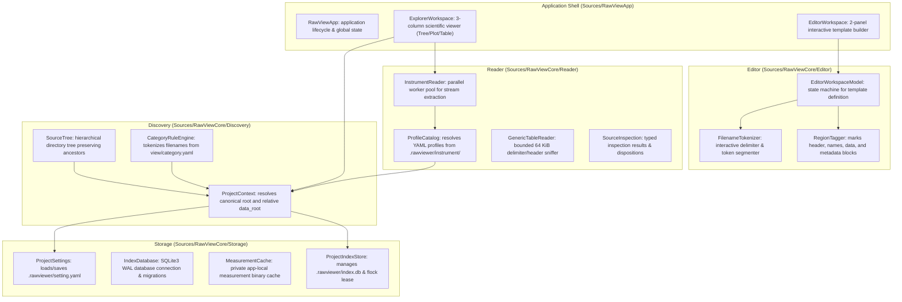

# RawView Developer and Agent Guide

This file defines the architecture, invariant contracts, and component graph for AI agents working on RawView.

## Register and Rules

Write instructions in Plain register: short imperative sentences, active voice, one instruction per sentence.
Never delete or split existing source files without explicit human authorization.
Raw scientific data files under project data roots are strictly read-only and immutable.

## Knowledge Graph and Component Map (Graphify)

The Swift package lives in `apps/macos/`. Paths in the map below are relative to that package.

RawView is organized into five decoupled core layers and two app workspaces.

## Invariants and Contracts

1. **Storage Invariant**: Writable index is located at `<project>/.rawviewer/index.db`. Zero project-local SQLite writes occur outside `.rawviewer/`. Legacy `data/.rawview/index.db` is read-only hints.
2. **Settings Invariant**: Project configuration is declarative and resides at `<project>/.rawviewer/setting.yaml`. Default view is `tree`. Default preset is `nature-single`.
3. **Profile Fallback**: Profiles are loaded from `<project>/.rawviewer/instrument/`. If missing, fallback to `data/.rawview/instrument/` and `data/instruments/` (ignoring empty directories).
4. **Editor Performance**: The raw data canvas displays a virtualized window of the first 500 lines to guarantee 120 FPS UI performance.
5. **Verification**: Always run `./apps/macos/Scripts/check_core.sh` and `./apps/macos/Scripts/check_index_cli.sh` before declaring completion. Rust workspace checks are `cargo fmt --check`, `cargo clippy --workspace -- -D warnings`, and `cargo test --workspace` from the repository root.
6. **Real-data fixture (#27)**: The public `fixtures/workspaces/usth-lab/` workspace holds eight approved lab files under `data/raw/` (immutable), measured expectations in `expected.yaml`, and legacy YAML under `fixtures/legacy/usth-lab/`. Rust checks live in `core/tests/usth_lab_fixture.rs`. Profile variant YAML under `.raw-viewer/profiles/` is #18; do not weaken golden or self-check tests when extending the fixture.
