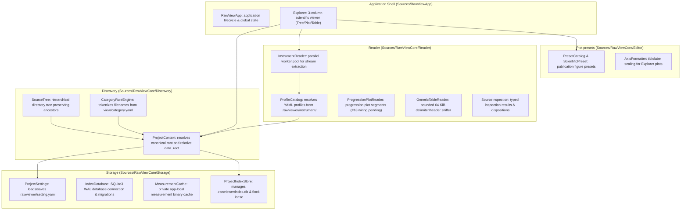

# RawView Developer and Agent Guide

This file defines the architecture, invariant contracts, and component graph for AI agents working on RawView.

## Register and Rules

Write instructions in Plain register: short imperative sentences, active voice, one instruction per sentence.
Never delete or split existing source files without explicit human authorization.
Raw scientific data files under project data roots are strictly read-only and immutable.

## Knowledge Graph and Component Map (Graphify)

The Swift package lives in `apps/macos/`. Paths in the map below are relative to that package.

RawView is organized into five decoupled core layers and a single Explorer workspace in the macOS app.

## Invariants and Contracts

1. **Storage Invariant**: Writable index is located at `<project>/.rawviewer/index.db`. Zero project-local SQLite writes occur outside `.rawviewer/`. Legacy `data/.rawview/index.db` is read-only hints.
2. **Settings Invariant**: Project configuration is declarative and resides at `<project>/.rawviewer/setting.yaml`. Default view is `tree`. Default preset is `nature-single`.
3. **Profile Fallback**: Profiles are loaded from `<project>/.rawviewer/instrument/`. If missing, fallback to `data/.rawview/instrument/` and `data/instruments/` (ignoring empty directories). The app must not write new YAML under `.rawviewer/instrument/` (read-only consumption until a dedicated profile pipeline lands).
4. **Verification**: Always run `./apps/macos/Scripts/check_core.sh` and `./apps/macos/Scripts/check_index_cli.sh` before declaring completion. Rust workspace checks are `cargo fmt --check`, `cargo clippy --workspace -- -D warnings`, and `cargo test --workspace` from the repository root.

## Rule enforcement

The gardener owns this table. Update it when rules or checks change.

| Rule (AGENTS.md) | Enforcing check | Status |
| --- | --- | --- |
| L7 — Write instructions in Plain register (short imperative sentences). | none | unenforced |
| L8 — Never delete or split existing source files without explicit human authorization. | none | unenforced |
| L9 — Raw scientific data under project data roots are read-only and immutable. | `apps/macos/Scripts/check_index_cli.sh:53-77` (macOS `stat -f`; swift CI job only) | partial |
| L13 — Graphify paths are relative to the Swift package in `apps/macos/`. | `.github/workflows/ci.yml:57-59` (swift job `working-directory: apps/macos`) | partial |
| L63 — Storage invariant (writable index only under `<project>/.rawviewer/index.db`; no other project-local SQLite writes). | `apps/macos/Scripts/CoreSelfCheck.swift:2845-2858`, `3656-3657` (`projectIndexStoreSelfCheck`) | partial |
| L64 — Settings invariant (`.rawviewer/setting.yaml`; default view `tree`; default preset `nature-single`). | `apps/macos/Scripts/check_index_cli.sh:65-69`; `apps/macos/Scripts/CoreSelfCheck.swift:2386-2398`; `core/src/config.rs:48-58`, `489-490` | partial |
| L65 — Profile fallback (load order; no writes under `.rawviewer/instrument/`). | `apps/macos/Scripts/CoreSelfCheck.swift:1076-1084` (priority/fallback); no automated check for the read-only write ban | partial |
| L66 — Verification gate (macOS check scripts + Rust fmt/clippy/test). | `.github/workflows/ci.yml:46-51`, `73-76` | partial |
| CI must be green on all jobs before merge. | `.github/workflows/ci.yml:15-76` (rust matrix + swift job steps) | enforced |

Required GitHub status checks on `master` are not configured (Tai's decision).

## Agent instruction index (`.agents/`)

`.agents/` is the tool-neutral home for agent skills, rules, and workflows. Planned install targets (#20/#25): `~/.agents/skills` and `~/.claude/skills`. Nothing in this repo reads `.cursor/` for these instructions.

| Path | Purpose |
| --- | --- |
| `.agents/rules/graphify.md` | Graphify rule pack for architecture maps |
| `.agents/workflows/graphify.md` | Graphify workflow steps |
| `.agents/skills/rawview-setup-grammar/SKILL.md` | Generate `.rawviewer/grammar.yaml` and source labels |
| `.agents/skills/rawview-setup-profile/SKILL.md` | Author instrument profiles from raw files |
| `.agents/skills/verify-raw-viewer/SKILL.md` | Linux Rust-core verification and proof logs |

**Staleness notes (follow-up issues):**

- `graphify-out/` output directory may be missing until Graphify runs in a checkout.
- Setup skills may still reference pre-`.agents/` paths; align with #20 when the install pipeline lands.
- Setup profile skill targets Schema v3; older docs may mention v1/v2 until #20 refreshes them.
