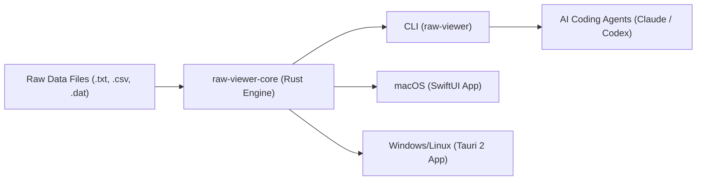

# RawView

<p align="center">
  <strong>Instant, offline, publication-grade scientific measurement viewer and agentic CLI.</strong>
</p>

<p align="center">
  <a href="https://github.com/taixuann/raw-viewer/actions/workflows/ci.yml"></a>
  <a href="https://github.com/taixuann/raw-viewer/releases"></a>
  <a href="LICENSE"></a>
  
  
</p>

---

RawView provides immediate, zero-latency inspection and visualization of laboratory instrument raw data directly from your local filesystem. It executes in-process with zero cloud dependencies, keeps original data files strictly read-only, and pairs a high-performance **Rust core** with native frontends (**SwiftUI** on macOS, **Tauri** on Windows/Linux) and an automation-first **CLI**.

---

## ⚡ Quick Install

### 1. One-Line Universal Installers

#### macOS & Linux (Bash / Zsh)
```bash
curl -fsSL https://raw.githubusercontent.com/taixuann/raw-viewer/master/install.sh | bash
```

#### Windows (PowerShell)
```powershell
irm https://raw.githubusercontent.com/taixuann/raw-viewer/master/install.ps1 | iex
```

---

### 2. Package Managers

#### Homebrew (macOS / Linux)
```bash
brew tap taixuann/tap
brew install raw-viewer
```

#### Cargo (Rust)
```bash
cargo install --git https://github.com/taixuann/raw-viewer.git raw-viewer-cli
```

---

### 3. Desktop Application Direct Downloads

| Platform | Frontend | Format | Download |
| :--- | :--- | :--- | :--- |
| **macOS** (Apple Silicon / Intel) | Native SwiftUI | `.zip` / `.dmg` | [Download macOS App](https://github.com/taixuann/raw-viewer/releases/latest) |
| **Windows** (x86_64) | Tauri Desktop Shell | `.zip` / `.msi` | [Download Windows Bundle](https://github.com/taixuann/raw-viewer/releases/latest) |
| **Linux** (x86_64) | Tauri Desktop Shell | `.tar.gz` / `.deb` | [Download Linux Bundle](https://github.com/taixuann/raw-viewer/releases/latest) |

---

## 🔬 Why RawView?

Traditional lab workflows rely on clumsy spreadsheets, slow Python scripts, or proprietary closed software:
- **100% Offline & Local**: Zero telemetry, zero cloud lock-in. Your confidential experimental runs remain on your machine.
- **Strict Read-Only Guarantee**: RawView never mutates, moves, or tags original scientific files. Indexes and caches are kept in platform cache directories outside your repository.
- **Smart Filename Grammar Engine**: Automatically extracts structured metadata (`date`, `sample`, `device`, `mode`, `remarks`) from messy laboratory filename conventions.
- **Multi-Publisher Publication Typography**: One-click styling presets calibrated to physical dimensions and typography for **Nature**, **Science**, **ACS**, and **IEEE**.
- **Agent-Ready AI Skills**: First-class JSON envelopes and built-in skills for AI coding agents (**Claude Code**, **Codex**, **Antigravity**).

---

## 🚀 30-Second CLI Quickstart

```bash
# 1. Verify your environment and project configuration
raw-viewer doctor

# 2. Test semantic token extraction against your lab's filename convention
raw-viewer grammar test --filename "20261101_keithley.iv_[sample1]_study_001.txt"

# 3. List active instrument profiles (Keithley 2400, Autolab CV/EIS, Keysight, etc.)
raw-viewer profiles list

# 4. Scan raw data files and match them to instrument profiles
raw-viewer files scan ./data/raw

# 5. Export structured measurements as JSON
raw-viewer files inspect ./data/raw/sample_iv.txt --profile usth/keithley-2400
```

> [!TIP]
> Add `--json` to any command for machine-readable JSON envelopes with predictable exit codes (`0` ok, `1` usage, `2` not found, `3` ambiguous profile, `4` validation error, `5` i/o error).

---

## 🤖 Built-in AI Agent Skills

RawView ships with native skills for autonomous agents (Claude Code, Codex, Antigravity) under `.agents/skills/`:
- `set-grammar`: Discover filename patterns in raw data and configure `.raw-viewer/grammar.yaml`.
- `set-profile`: Inspect raw instrument data headers/delimiters and generate Schema v4 profiles.

Install them into your local AI environment in one command:
```bash
# Install skills into ~/.agents/skills/ and ~/.claude/skills/
raw-viewer skills install

# Repair or refresh existing symlinks
raw-viewer skills repair
```

---

## 📐 Architecture & Layout

```
raw-viewer/
├── core/          raw-viewer-core: Rust engine for paths, grammars, v1–v4 profiles, and indexing.
├── apps/
│   ├── cli/       raw-viewer: Headless CLI with JSON envelopes, grammar testing, and skills manager.
│   ├── macos/     Native SwiftUI 3-column viewer (Tree / Plot / Table) with FigRecipe presets.
│   └── tauri/     Cross-platform desktop application shell for Windows & Linux (Tauri 2).
├── bindings/      Rust C-ABI and UniFFI bindings.
├── assets/        Built-in configurations and instrument profiles (usth/...).
├── fixtures/      Golden data fixtures and cross-language contract verification.
└── docs/          Architecture Decision Records, layout blueprints, and release notes.
```



---

## ⚙️ Configuration & Project Hierarchy

RawView projects are completely declarative. A single project config is stored in `.raw-viewer/config.yaml`.

### Project Layout

```
<project_root>/
  ├── data/
  │   └── raw/               # Raw scientific data files (read-only, immutable)
  └── .raw-viewer/
      ├── config.yaml        # Project configuration (schema_version: 1)
      ├── grammar.yaml       # Optional project filename grammar catalog
      ├── profiles/          # Custom project instrument profiles (<id>.yaml)
      └── session/           # Local UI session state
```

### Configuration Precedence

1. **Global Configuration**:
   - macOS / Linux: `~/.config/raw-viewer/config.yaml` (or `$XDG_CONFIG_HOME/raw-viewer/config.yaml`)
   - Windows: `%APPDATA%\raw-viewer\config.yaml`
2. **Project Configuration**: `<project_root>/.raw-viewer/config.yaml`
3. **Cache & Index Database**:
   - Placed outside the project root at `<platform_cache>/raw-viewer/projects/<hash>/index.db`.

> [!NOTE]
> **Legacy Migration**: RawView automatically resolves legacy `.rawviewer` directories if present, maintaining seamless backward compatibility.

---

## 🛠️ Local Development & Contributing

### Prerequisites
- **Rust**: 1.83+ (`rustup default stable`)
- **Swift**: 6.0+ (macOS SwiftUI development)
- **Node.js**: 20+ (Tauri frontend development)

### Verification Suite
Install git pre-push hooks to enforce quality checks automatically before every push:
```bash
./Scripts/install_git_hooks.sh
```

Run the full local verification suite:
```bash
# Runs format, clippy, workspace tests, swift checks, and PR contract checkers
./Scripts/pre_push.sh
```

Or run individual verification steps:
```bash
cargo fmt --check
cargo clippy --workspace --all-targets -- -D warnings
cargo test --workspace
```
