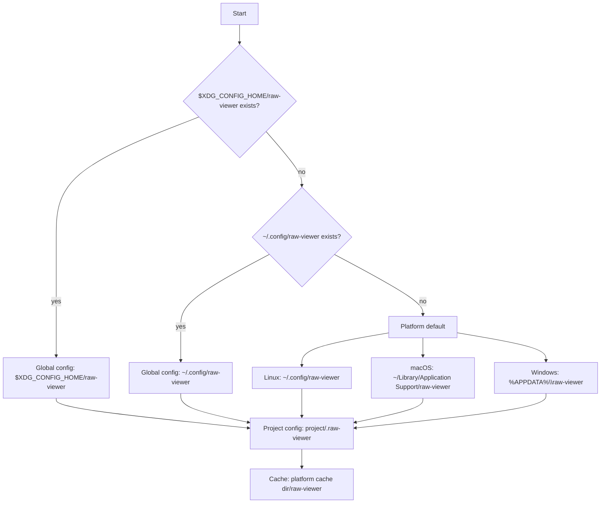

# Config and paths

RawView's Rust core chooses three directories. It does not create them when it reads them.

## Global config

The global config directory holds `config.toml`.

1. If `$XDG_CONFIG_HOME/raw-viewer` exists, use it.
2. Otherwise, if `~/.config/raw-viewer` exists, use it.
3. Otherwise, use the platform default:
   - Linux: `~/.config/raw-viewer`
   - macOS: `~/Library/Application Support/raw-viewer`
   - Windows: `%APPDATA%\raw-viewer`

`$XDG_CONFIG_HOME` is checked on every operating system. A relative or empty value is ignored. The platform default is used even when that directory does not exist yet.

On Linux, step 3 is `$HOME/.config/raw-viewer` even when `$XDG_CONFIG_HOME` is set. The variable is an override only when `raw-viewer` already exists inside it.

Windows `%APPDATA%` and `%LOCALAPPDATA%` come from the `directories` crate (`BaseDirs`), which reads the system known folders.

## Project config

Project settings live in `<project>/.raw-viewer/config.toml`.

The project root must be an absolute path. A relative root is an error. The config directory does not have to exist.

The Swift app still stores its settings in `<project>/.rawviewer/`. The Rust core does not read or migrate that directory.

## Cache

The cache directory is the platform cache directory plus `raw-viewer`:

- Linux: `$XDG_CACHE_HOME/raw-viewer`, or `~/.cache/raw-viewer` when that variable is unset or relative
- macOS: `~/Library/Caches/raw-viewer`
- Windows: `%LOCALAPPDATA%\raw-viewer`

The cache is not placed inside the project and is not inside `.raw-viewer`.



## config.toml

Each config directory has its own `config.toml`. A missing file loads defaults. Loading does not create the directory and does not write the file.

The file is a flat table: top-level keys only. A `[section]` is an unknown field named after that section. Nested tables are not settings.

Global keys:

| Key | Default | Meaning |
| --- | --- | --- |
| `recent_projects` | `[]` | Project paths opened recently |

Project keys:

| Key | Default | Meaning |
| --- | --- | --- |
| `data_root` | `data/raw` | Raw measurements, relative to the project. Allowed: `.`, or `/`-separated segments that are not empty, `.`, or `..`. Absolute paths, a leading `~`, backslashes, and control characters are rejected. |
| `default_view` | `tree` | Explorer view |
| `default_preset` | `nature-single` | Plot preset |

Omitted keys keep those defaults. A value of the wrong type, or a key that is not in the table, is an error. The error names the file path and the field. A file that is not valid TOML names the file; the parser message is included.

Example project file:

```toml
data_root = "measurements"
default_view = "tree"
default_preset = "nature-single"
```
