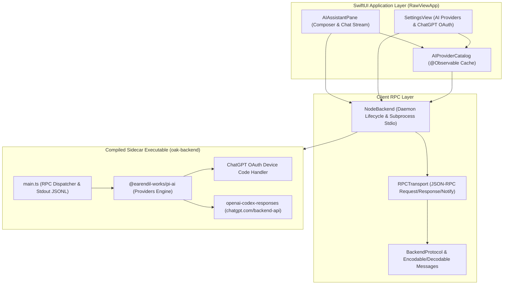

# Spec: OakReader Sidecar Backend & ChatGPT Subscription Integration

## Goal
Replace isolated, one-off CLI subprocess invocations (`AIAgentController`) in RawView with OakReader's robust, compiled Node/Bun sidecar backend daemon (`oak-backend`). Provide continuous JSON-RPC over stdio, native ChatGPT Subscription OAuth (Device Code flow), dynamic model discovery via `@earendil-works/pi-ai`, and real-time streaming to the global AI Assistant drawer.

---

## Architectural Context & Motivation
1. **Subprocess Limitations**: Invoking CLI tools (`opencode`, `codex`) per message creates latency, cannot support token streaming cleanly, and lacks standard session management or subscription OAuth.
2. **OakReader Proven Architecture**: OakReader ships a compiled standalone sidecar executable (`oak-backend`) built with Bun (`bun build --compile`), embedding `@earendil-works/pi-ai` and `@earendil-works/pi-agent-core`. The Swift application talks to `oak-backend` via line-delimited JSON-RPC over stdio pipes.
3. **ChatGPT Subscription Access**: The sidecar implements the `openai-codex` provider which connects to `https://chatgpt.com/backend-api` using ChatGPT Subscription credentials (`CLIENT_ID = "app_EMoamEEZ73f0CkXaXp7hrann"`). Users authenticate once via OAuth Device Code (`auth.openai.com/codex/device`) without pay-per-token API keys.
4. **Dynamic Model Discovery**: Instead of hardcoding model lists in Swift, `oak-backend` queries its provider catalog (`list_providers`), allowing instantaneous model updates when SDK definitions change.

---

## Component Architecture

---

## Implementation Details

### 1. Sidecar Executable Packaging
- Source: `/Users/tai/oakreader-src/backend/dist/oak-backend`.
- Packaging: `./Scripts/package_app.sh` will copy `oak-backend` into `/tmp/RawView.app/Contents/Resources/oak-backend`.
- Development fallback: `NodeBackend.findBinary()` checks bundle resources, falling back to `/Users/tai/oakreader-src/backend/dist/oak-backend` in debug/local runs.

### 2. Swift RPC & Services Layer
- Directory: `Sources/RawViewApp/Services/Backend/`
  - `NodeBackend.swift`: Starts and supervises the `oak-backend` process; monitors health; recovers on crash.
  - `RPCTransport.swift`: Encodes outgoing JSON-RPC requests; parses newline-delimited JSONL responses and events; routes reverse requests (`oauth/prompt`).
  - `BackendProtocol.swift` & `BackendProtocol.generated.swift`: Typed structs for all RPC methods (`providers/list`, `oauth/login`, `oauth/notify`, `oauth/prompt`, `chat/stream`, `credentials/set`, etc.).
  - `AIProviderCatalog.swift`: `@Observable` store maintaining dynamic provider and model lists for SwiftUI views.

### 3. ChatGPT Subscription OAuth in Settings
- Add OAuth Device Code flow to `SettingsView.swift`:
  - When user selects `openai-codex` or clicks "Connect ChatGPT Subscription", trigger `NodeBackend.shared.call("oauth/login", ...)`.
  - Listen for `oauth/notify` returning the 8-character verification code and URI (`https://auth.openai.com/codex/device`).
  - Present user-friendly code banner with "Copy & Open in Browser" button.
  - Automatically poll and resolve upon user approval; persist tokens in credentials store.

### 4. AIAssistantPane Integration
- Populate model picker dynamically from `AIProviderCatalog.shared.availableModels`.
- When user sends a prompt, dispatch through `NodeBackend.shared.stream(...)` using the active provider (`openai-codex` or `opencode` / OpenRouter).
- Stream text tokens in real-time into the current assistant turn.
- Preserve append-only `.rawviewer/session/<YYYY-MM-DD>/<session-id>.jsonl` persistence.

---

## Verification Plan
1. **Compilation**: `swift build` and `swift test` pass cleanly.
2. **Daemon Spawning**: `NodeBackend.shared.start()` launches `oak-backend` without crash.
3. **Provider Enumeration**: `providers/list` RPC returns live models including `gpt-6.1-sol`, `gpt-6-astra`, `gpt-5.6-luna/sol/terra`, etc.
4. **App Packaging**: `./Scripts/package_app.sh` packages `oak-backend` inside `RawView.app/Contents/Resources`.
5. **End-to-End Test**: Launch `/tmp/RawView.app`, verify model dropdown loads dynamic models from backend, and test chat generation.
