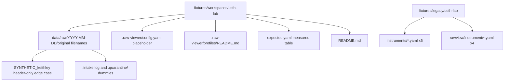

# usth-lab real-data workspace fixture

Public regression workspace for [issue #27](https://github.com/taixuann/raw-viewer/issues/27). Eight committed lab files keep original filenames under `data/raw/<YYYY-MM-DD>/`. Tai approved committing these bytes on 2026-10-31.

Variant instrument profiles (`autolab-usth.yaml`, `keithley-2400.yaml`, `horiba-labram.yaml`, `iop-hanoi.yaml`) land in #18 under `.raw-viewer/profiles/`. Legacy YAML for #24 migration tests lives in `fixtures/legacy/usth-lab/`.

Keysight B1500A modes remain deferred.

## Layout



## Expected results (measured 2026-10-31)

Machine-readable source: `expected.yaml`. Row counts are data rows after headers (LabVIEW: after the second `***End_of_Header***` and column header row).

| id | profile / variant | rows | columns | x (quantity, unit) | y (quantity, unit) | metadata keys | plotted |
| --- | --- | ---: | --- | --- | --- | --- | --- |
| keithley-dual-sweep | `keithley-2400` / `dual-sweep` | 121 | 5 (LVM tab) | voltage, V | current, A | Writer_Version, Reader_Version, Separator, Date, Time, Operator, Samples, … | yes |
| autolab-cv | `autolab-usth` / `cv` | 4100 | 9 (`;`, comma decimal) | voltage, V | current, A | — | yes |
| autolab-ca | `autolab-usth` / `ca` | 1000 | 7 | time, s | current, A | — | yes |
| autolab-eis | `autolab-usth` / `eis` | 50 | 7 | frequency, Hz | impedance_real, ohm | — | yes |
| horiba-raman | `horiba-labram` / `raman` | 1853 | 2 (`raman_shift;intensity`) | wavenumber, cm-1 | intensity, counts | — | yes |
| iop-hanoi-uv-vis | `iop-hanoi` / `uv-vis` | 326 | 2 (`Wavelength_nm,T%`) | wavelength, nm | transmittance, % | — | yes |
| gtiit-xps-survey | `gtiit-xps` / `survey` | 0 (`.spe` binary) | — | — | — | — | listed, not plotted |
| oxford-mfp-contact-afm | `oxford-mfp` / `contact-afm` | 0 (`.ibw` binary) | — | — | — | — | listed, not plotted |
| keithley-header-only | `keithley-2400` / `dual-sweep` (synthetic) | 0 | 5 (header only) | voltage, V | current, A | same LVM header keys as source file | no data rows |

### Synthetic edge case

`data/raw/2026-10-07/SYNTHETIC_keithley-2400.dual-sweep_header-only_no-data-rows.txt` is derived from the reproducible dual-sweep file: both LabVIEW header blocks and the column header row, with all measurement rows removed. Use it to assert a clear **no data rows** disposition once #18 profiles ship.

### Discovery ignore placeholders

`data/raw/2026-10-07/.intake.log` and `data/raw/2026-10-07/.quarantine/` are dummy entries for intake/quarantine ignore rules. They are not instrument data.

## Tests

Rust harness: `core/tests/usth_lab_fixture.rs` loads `expected.yaml` and checks file presence, `sha256`, sizes, and remeasured row counts. `.spe` rejection is asserted today. Profile axes, metadata, discovery ignores, and header-only disposition tests are `#[ignore]` until #18 and the shared discovery port land.

Run from the repository root:

```bash
cargo test -p raw-viewer-core --test usth_lab_fixture
```
